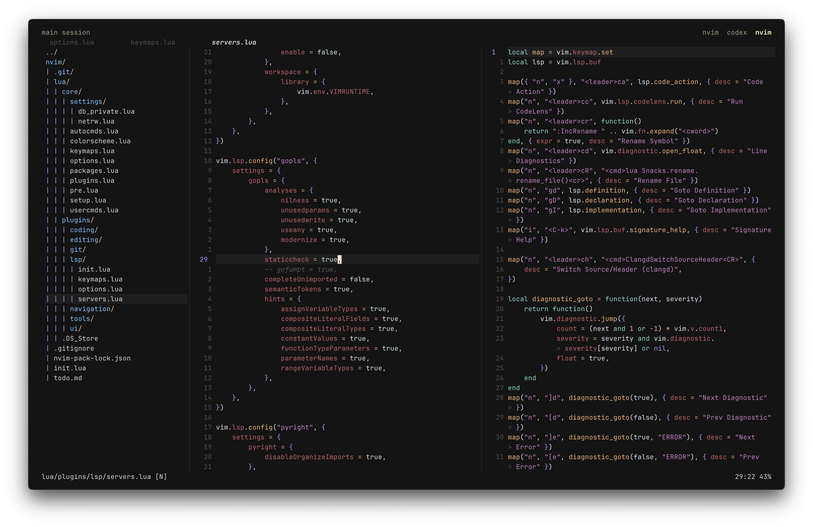

# Neovim config

My personal Neovim configuration, built around the built-in `vim.pack` package manager. It aims for an IDE-like workflow using Neovim's built-in features wherever practical and plugins where they help.

## Features

| Area | How it works |
| --- | --- |
| Search | Telescope finds files, buffers, projects, symbols, and diagnostics, with live grep for text search. |
| Navigation | `vim-tmux-navigator` moves between Neovim splits and tmux panes; netrw provides a built-in file explorer. |
| Language support | Neovim's built-in LSP handles diagnostics, definitions, references, renaming, code actions, and inlay hints. |
| Completion | `blink.cmp` combines LSP suggestions, paths, snippets, and buffer words. |
| Formatting and linting | `conform.nvim` formats on save; `nvim-lint` runs configured linters. |
| Git | `gitsigns.nvim` shows changes and supports hunk navigation, staging, preview, blame, and diff. |
| Syntax and editing | Treesitter provides highlighting and text objects for code-aware selection and movement. |
| Sessions | `persistence.nvim` saves and restores editing sessions. |

